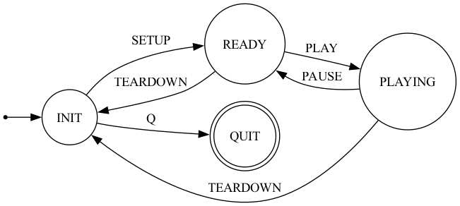

# Programming Assignment

This project implements a client-server system with control and feedback capabilities. The system consists of a server that streams data according to control requests and a client that receives streamed data, with the ability to send quality feedback and control the data stream.

## Project Structure

- Starter code is provided for `client.py` and `server.py`.
- You need to fill in the blanks and may adjust other parts of the code as needed.
- In the `executable` folder, we provide two executables, `client` and `server`, for your reference.
    - Try them before you code to understand the expectation. 
- When programming `client.py`, you can run `./executable/server` in another terminal to connect to and receive messages from the server.
- When programming `server.py`, you can use your `client.py` or `./executable/client` to connect to the server you programmed and test.
- In the `reference log` folder, several example log files that record the expected output for both the client and server are provided. You may also run the executables to check the expected behavior.

## Assignment Requirements

- Three sockets should be (or have been) created in both the client and the server:
    - `ctrl_socket` – socket for the **control channel**
    - `data_socket` – socket for the **data channel**
    - `quality_socket` – socket for the **quality feedback channel**

### Control Channel

- The client connects to the server using the `ctrl_socket` (TCP) and implements the following control protocol:
    - `SETUP`: Initialize the streaming session
    - `PLAY`: Start data streaming
    - `PAUSE`: Pause data streaming
    - `TEARDOWN`: End the streaming session
- Before/during/after data streaming, the following control commands are available (and implemented in the starter code):
    - Press `Enter` to start
    - Press `"1"` to pause data streaming and press `Enter` to resume
    - Press `"2"` to teardown data streaming
    - Press `"R"` to restart the session after streaming is done or is torn down
    - Press `"Q"` to quit the application
- Accordingly there are four possible states: 
    
- **Server port number for `ctrl_socket`: 8000**

### Data Channel

- The server uses the client's IP address (received via the control socket) to initiate the data stream using `data_socket` (UDP).
    - The server sends **10 sequential data segments** to the client.
    - The server initiates this connection.
    - The socket should close upon timeout (i.e., when transmission is finished).
- **Client port number for `data_socket`: 5390**

### Quality Feedback Channel

- The client sends quality feedback to the server for **each data segment received** using the `quality_socket` (UDP).
    - The quality value can be any float randomly chosen from **0 to 1**.
    - This functionality will be expanded further in Part 2.
- **Server port number for `quality_socket`: 8220**

---

## Server-side Functionality

The server will:
- Listen on port **8000** for control connections
- Listen on port **8220** for quality feedback
- Wait for client connections
- Stream data to port **5390**
- Log all activities to `server_log_server.txt`
- Use `self.logger.log_print(message)` to log received messages.

## Client-side Functionality

The client will:
- Connect to the server
- Listen on port **5390** for incoming data after the connection is established
- Send quality feedback for every segment received
- Change the data streaming state based on control commands and send control requests to the server
- Log all activities to `client_log.txt`

---

## Grading Rubric

- **80%** for a functional `client.py`
- **20%** for documentation: explain every command and functions' functionalities with comments
- **+50% Bonus** for a functional `server.py` **before the P1 deadline**
    - (Server-side functionality will be expanded in Part 2. Completing it early will help with P2.)

